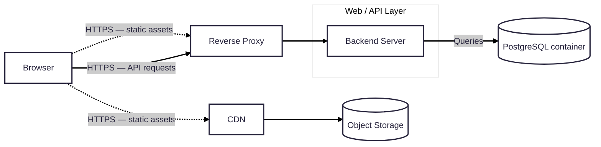
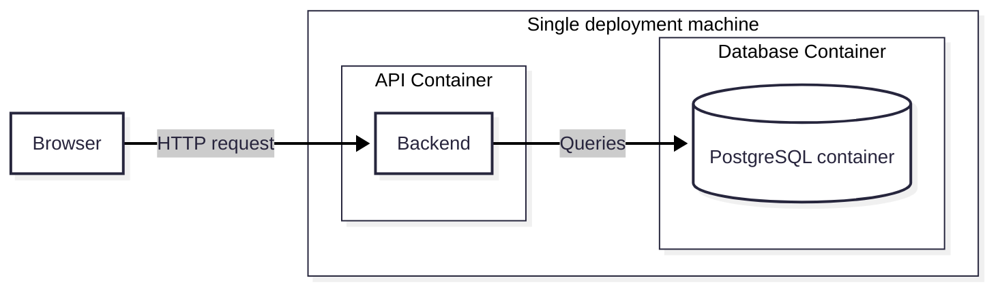
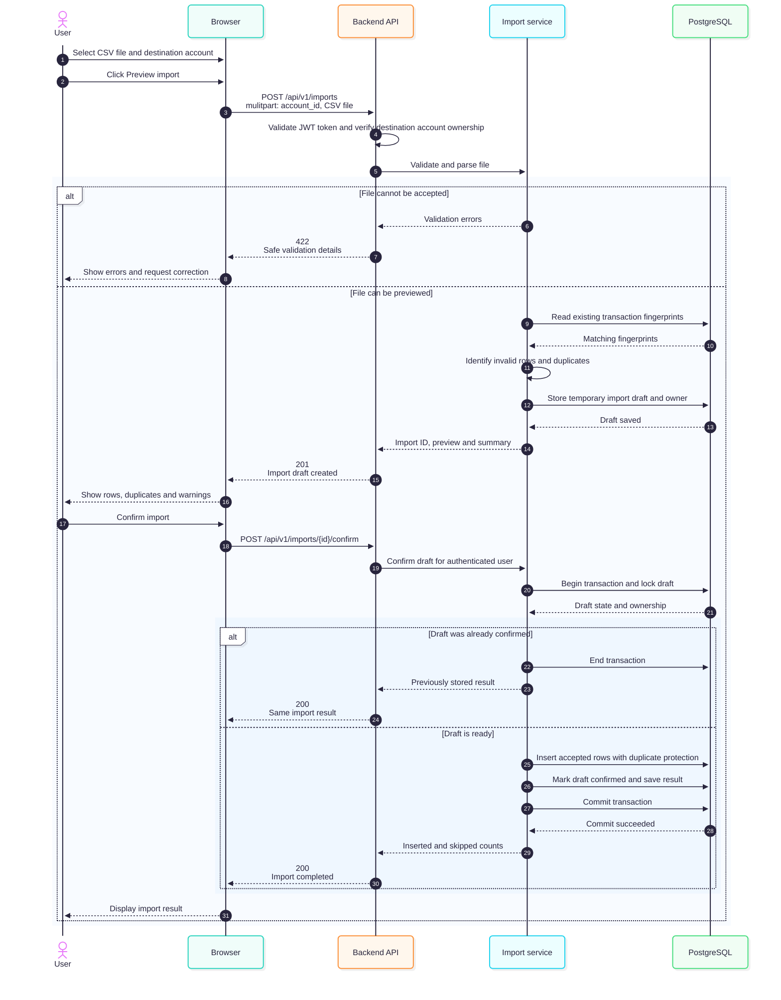
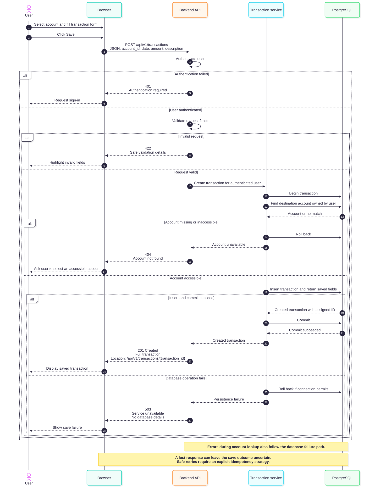
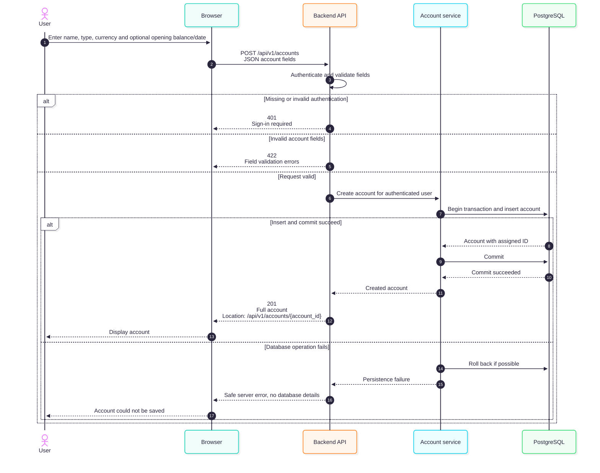
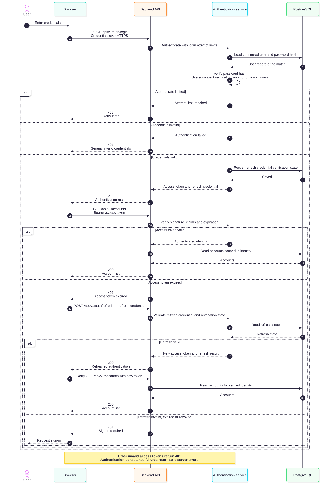
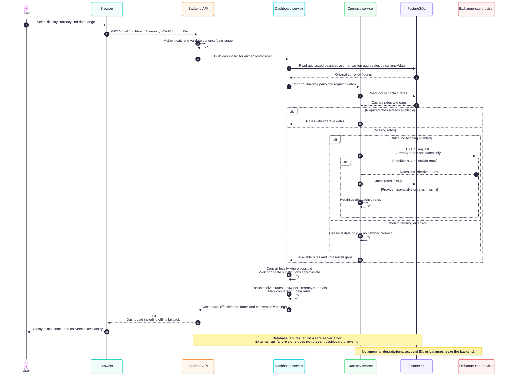
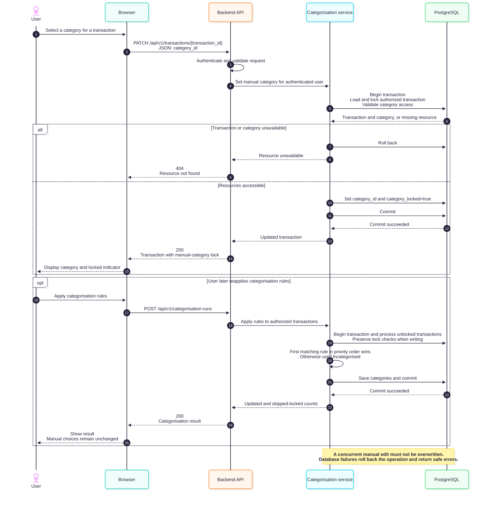
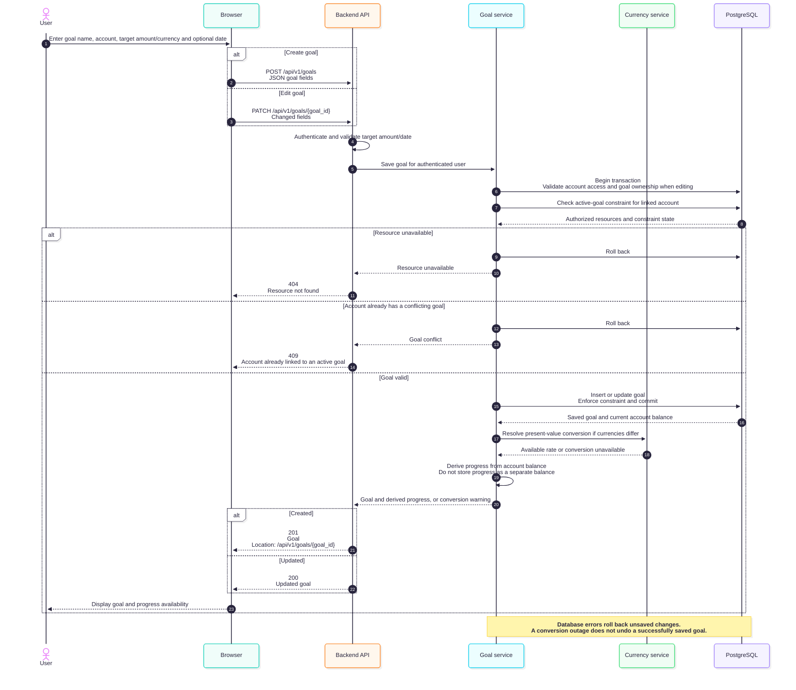
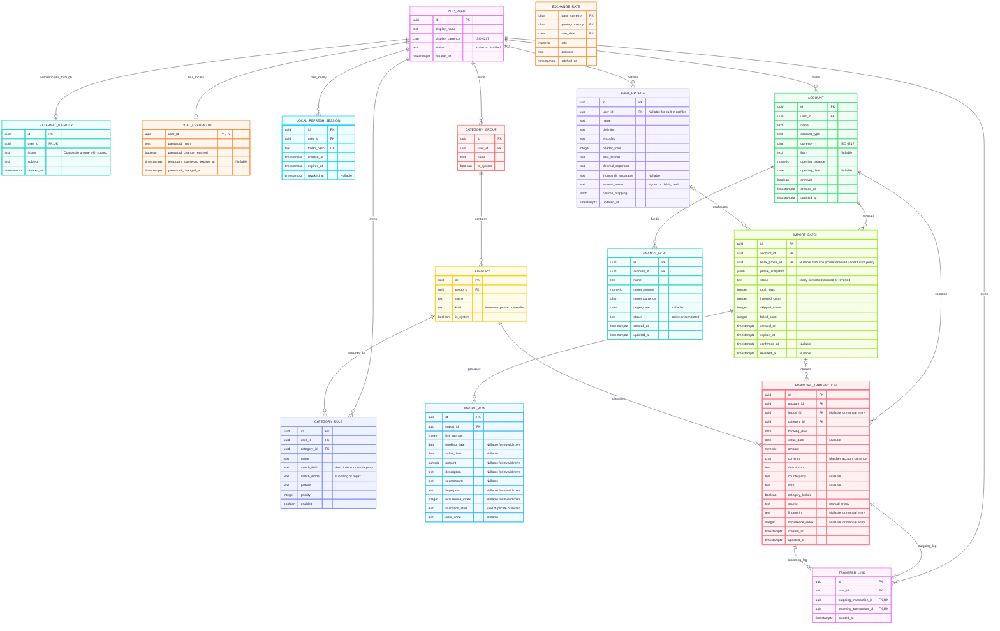

# System Design for PersonalSaving

## 1. Requirements & Assumptions

I estimate a maximum of roughly 100 users per month (if the software would be deployed on a cloud service). This means, the system should be designed to
run at least 10 concurrent users.

The core requirements include (for more detail see [PRD.md](PRD.md)):

- Users can upload their bank statements.
- Users can manually add bank statements.
- Users can manually add bank accounts.
- Users can add saving coals.
- Users can observe their spendings and income.
- Users can observe their bank account and saving status.
- Basic monitoring and observability (health checks, error tracking, performance metrics)

For bank statements, V1 only supports .csv files. However, such files can be multiple kB in size.

On average, a user will upload 4 times per month, with each upload beeing max 1MB in size. The same user will open the obervibility pannel in the UI 4 times per week.

## 2. Capacity Planning

### 2.1 User metadata

- User profiles and preferences: ~1kB x 100 users = 100kB

### 2.2 CSV upload

- 100 users x 4 uploads/month x 1MB = 0.5GB of uploaded data per month as peak.
- In reality I estimate: 10 users x 2 uploads/month x 10kB = 0.5MB of uploaded data per month

### 2.3 Daily bandwidth

- The average time spent on the application will be <10' per session where users upload twice per month and mostly ready their data:
  - 100kB of user data
  - 10kB of backend data per session
- So the daily bandwidth will be less than 100kB of reads and less than 100kB or writes.

## 3 High level Architecture

This diagram describes the target v1.0 architecture. Version 0.1 colocates the application and database on one machine.

### 3.1 V1.0 Architecture

Dashed connections represent alternative static-asset delivery options. The final choice remains open.



A CDN caches and distributes static files such as images, CSS and HTML files for the frontend. However, this may also be handled by the Proxy. A CDN would fetch the data from an object storage server such as Amazon's S3. Alternatively, the reverse proxy serves frontend files directly from disk on the application server and forwards API requests to FastAPI. This decision remains open.

### 3.2 V0.1 Architecture



## 4. System Workflow

### 4.1 CSV Import



### 4.2 Manual transation creation



### 4.3 Create a bank account

The API assigns ownership from the authenticated identity; the client cannot choose
an owner. Account currency and opening balance remain in their original units.
The following endpoint contracts describe the target design.



### 4.4 Login and authenticated request

This follows ADR 0004's short-lived JWT access token and longer-lived refresh
credential. Credential storage, refresh rotation and revocation must be specified
in the authentication contract; the sequence does not prescribe browser storage.
No tokens or passwords are logged. The deployment has one user, with no public
registration endpoint.



### 4.5 View dashboard in a chosen currency

Following ADR 0005, balances use the latest available rate and historical
aggregates use booking-date rates. The cache is a PostgreSQL table, not an
additional cache server. Conversion never changes original monetary values.



### 4.6 Edit a transaction's category

ADR 0007 requires manual category changes to lock the transaction against later
rule runs. Updating the category and setting the lock are one atomic operation.
The rule-run endpoint below is a proposed target contract.



### 4.7 Create or update a savings goal

ADR 0008 defines progress from one linked account's balance, rather than manually
maintained contributions. This design assumes one active goal per account;
confirm that constraint before implementation. Currency conversion follows ADR 0005.



### 4.8 Delete an account

This chapter requires more thinking and will be designed and implemented later.

## 5. API Design

### 5.1 Conventions

These conventions define the target API. The generated `backend/openapi.json`
is the detailed contract for implemented endpoints.

#### Base path and versioning

- Business endpoints use the prefix `/api/v1`.
- Operational readiness remains at `GET /api/health`, outside the version prefix.
- The deployment base URL is configurable. Clients must not hardcode a hostname
  or assume that the development port is the production port.
- Breaking changes to released request or response contracts require a new API
  major version. Compatible additions remain in the existing version. Changing
  an HTTP method also changes the contract.
- Paths use no trailing slash. Clients should use the documented address rather
  than rely on automatic redirects.

#### Resource names and identifiers

- Collection names are plural nouns, such as `/accounts`, `/transactions`,
  `/imports` and `/goals`. Multiword path segments use lowercase kebab-case,
  such as `/bank-profiles` and `/category-rules`.
- A path identifier names the resource immediately before it:
  `/imports/{import_id}` identifies an import, not an account.
- JSON fields, query parameters and documented path parameters use `snake_case`.
- Identifiers are opaque strings. Clients must not parse them or infer ordering,
  ownership or permissions from their values. Their concrete format is defined
  by the corresponding OpenAPI schema.
- Relationships may be expressed with shallow nesting, such as
  `/accounts/{account_id}/transactions`. For the selected flat creation
  endpoints, the account reference is supplied in the request body instead.
- Explicit operations such as `/imports/{import_id}/confirm` are permitted when
  a normal resource update would obscure the business action.

#### Request and response representations

- Structured requests and responses use `application/json`, except file uploads
  and responses that intentionally have no body.
- CSV preview creation uses `POST /api/v1/imports` with `multipart/form-data`:
  `account_id` identifies the destination and `file` contains the CSV bytes.
  The client must let its multipart library generate the boundary.
- Manual transaction creation uses `POST /api/v1/transactions` with JSON. It
  creates a transaction directly, rather than an import draft.
- Monetary amounts and exchange rates are decimal strings, for example
  `"amount": "-42.50"`. They are processed with exact decimal arithmetic, never
  binary floating point. Negative transaction amounts represent outflows and
  positive amounts represent inflows. Precision and scale are specified per field.
- Currency codes are uppercase ISO 4217 codes, such as `CHF` and `EUR`.
- Booking dates and other calendar dates use `YYYY-MM-DD`, without timezone
  conversion. Audit timestamps, where exposed, use RFC 3339 in UTC, such as
  `2026-10-30T09:15:00Z`. A booking date is not an instant in time.
- Single-resource success responses return the resource directly. Creation
  responses normally include the assigned ID and a `Location` header pointing
  to its resource URL. List responses use a documented pagination envelope.

#### Pagination, filtering and sorting

The initial pagination convention is bounded offset pagination: `limit` defaults
to 50, must be between 1 and 200, and `offset` defaults to 0 and must be nonnegative.
Out-of-range values return validation errors rather than silently changing the
requested limit. These are initial design defaults to review against actual UI
needs before publishing the endpoints.

Simple list endpoints accept filters and pagination in query parameters.
Transaction search carries them in its JSON body. List responses have this shape:

```json
{
  "items": [],
  "limit": 50,
  "offset": 0,
  "has_more": false
}
```

`has_more` reports whether additional matching records existed when the page was
queried; it does not promise a stable snapshot across separate requests. Sorting
uses documented allowlisted fields, with an ID as the final tie-breaker so equal
sort values have deterministic ordering. Transaction lists default to booking
date descending, then ID descending. The endpoint schema defines the concrete
sort parameter representation.

Offset pagination is sufficient for the expected initial dataset and supports
simple page navigation. Cursor pagination is an alternative if dataset size or
frequent concurrent changes make offsets unsuitable; it is not an additional
pagination mode clients must implement now.

#### Status codes, authorization and retries

- `200 OK`: successful retrieval, update or operation with a response body.
- `201 Created`: a new resource was created, including an import draft.
- `204 No Content`: successful deletion with no response body.
- `401 Unauthorized`: authentication is missing or invalid.
- `404 Not Found`: a resource does not exist or is unavailable to the caller.
  Resource-scoped endpoints do not disclose another user's resource existence.
- `409 Conflict`: the requested operation conflicts with the resource's current
  state or an enforced business constraint.
- `422 Unprocessable Content`: request fields or accepted-format file contents
  fail semantic validation. Malformed request syntax may instead produce `400`.
- `413 Content Too Large`, `415 Unsupported Media Type` and `429 Too Many
  Requests` cover upload limits, unsupported representations and configured
  authentication attempt limits respectively.
- `503 Service Unavailable`: a required dependency is temporarily unavailable.
  Unexpected implementation errors remain `500`. They are not all mapped to 503.

An exchange-rate outage alone does not fail dashboard browsing: return the
available per-currency figures with explicit conversion warnings, as specified
in [ADR 0005](adr/0005-currency-conversion-strategy.md).

Authentication and resource access are checked server-side. A supplied
`account_id` establishes the requested destination, not permission to use it.
Responses never expose database errors, credentials or stack traces. Financial
payloads and authentication credentials must not be written to logs.

A successful persistence response is sent only after commit. A lost response
still leaves the client uncertain whether the commit happened. Creation `POST`
requests are not automatically safe to retry. Import confirmation must return
its stored result when repeated, without inserting transactions again. Other
retry and idempotency contracts, and the shared error representation, are defined
in section 5.5; clients must not assume an idempotency header is supported until
it is documented and implemented.

#### Contract maintenance

Request and response schemas are declared in code and published through OpenAPI.
The exporter sorts JSON keys, uses consistent indentation and a trailing newline,
and excludes deployment-specific `servers` entries from the committed copy.
Every implemented contract change includes a regenerated `backend/openapi.json`;
CI rejects drift between that file and the application. Endpoint paths and
examples in this document must be updated alongside those changes.

### 5.2 Authentication

#### User provisioning

For local version V0.1, there exists only one user. This user has initial login credentials defined in `.env`. On the first login, the user then can set its name and must change its passwort. If the user forgets the passwort, there is a local administrative CLI command to set a new one-time passwort, with with the user can login once and set its new passwort.

V1.0 delegates authentication to an OpenID Connect provider using Authorization Code with PKCE. The provider remains undecided. Amazon Cognito User Pools is a candidate for managed hosting. PersonalSaving retains responsibility for financial-data authorization.

#### Login

**V0.1:** The client submits credentials to
`POST /api/v1/auth/login` over HTTPS, except during local development.
The backend verifies the password against its stored Argon2id hash.
Invalid credentials return a generic `401 Unauthorized` response.
Initial and one-time credentials require a password change before
normal application access.

**V1.0:** Login is handled by the selected OpenID Connect provider
using Authorization Code with PKCE. PersonalSaving does not receive
the user's provider password. After successful authentication, the
verified identity is associated with an application user.

Request/response formats, token lifetimes and browser credential
handling will be specified before authentication is implemented.

#### Authenticated requests

Financial API endpoints require authentication. Clients present an
access token using the `Authorization: Bearer <token>` header.

The backend validates the token and resolves it to an application user.
Missing, expired or invalid tokens return `401 Unauthorized`.

For V1.0, each operation is restricted to the authenticated user's
resources. Resource identifiers supplied by the client do not establish
permission. Administrator privileges do not grant access to other users'
financial data.

Readiness and the authentication entry points required by each version
are exceptions. Their exact routes will be documented in the endpoint
overview.

#### Token refresh

Access tokens have a limited lifetime. A valid refresh credential allows
the client to obtain a new access token without entering credentials again.

**V0.1:** PersonalSaving validates refresh credentials and issues new
access tokens through a dedicated refresh endpoint.

**V1.0:** Refresh is handled through the selected identity provider.

If the refresh credential is expired, invalid or revoked, the client
must request sign-in again.

Refresh credential storage, expiration, rotation and revocation behavior
will be specified before authentication is implemented.

#### Logout and revocation

Logout clears the client's authentication state and invalidates the
current session's refresh credential, preventing further token refresh.

**V0.1:** PersonalSaving performs refresh-credential revocation.

**V1.0:** Logout uses the selected identity provider's supported session
termination and revocation mechanisms.

Already issued access tokens may remain valid until they expire.
Immediate access-token invalidation and logout from all devices remain
separate decisions to resolve before implementation.

#### Browser credential handling

Passwords and tokens must not appear in URLs or application logs.
The browser clears its application-held credentials on logout.

Browser token storage and refresh-credential transport remain undecided.
Before implementation, choose between browser-managed tokens and a
server-managed session using secure cookies, and define the corresponding
XSS and CSRF protections.

The client must not contain a confidential OAuth client secret.

#### Authentication failures and protections

Invalid login credentials return a generic error that does not reveal
whether a user exists. Missing, invalid or expired access tokens return
`401 Unauthorized`.

Login attempts are subject to backoff or rate limiting. Recovery and
one-time credentials must also be protected against repeated guessing.

Authentication uses HTTPS outside local development. Responses and logs
must not expose passwords, tokens, password hashes or internal error details.

For V1.0, provider-managed authentication protections are configured at the
identity provider. PersonalSaving remains responsible for validating
authenticated requests and enforcing financial-data authorization.

### 5.3 Endpoint Overview

This is the initial target API inventory, not a list of implemented routes.
Business paths below are relative to `/api/v1` and require authentication unless
stated otherwise. In v1.0, all financial operations are scoped to the authenticated
user; administrator status does not bypass those checks. Success codes describe
the normal completed operation, not its possible error responses.

#### Authentication and operations

Authentication paths below describe local v0.1 only. V1.0 uses the selected OIDC
provider; provider endpoints and any application callback/session routes remain
undecided. No public user-registration endpoint is proposed.

| Method | Path | Purpose | Success | Access |
|---|---|---|---|---|
| `POST` | `/auth/login` | Verify local credentials and begin sign-in | 200 | Credentials; restricted setup flow for initial/one-time passwords |
| `POST` | `/auth/refresh` | Obtain a new access token | 200 | Valid refresh credential |
| `POST` | `/auth/logout` | Revoke the current refresh session | 204 | Session/refresh verification mechanism pending |
| `POST` | `/auth/password/change` | Set or change the local password | 204 | Normal authenticated proof or restricted setup/recovery credential; contract pending |
| `GET` | **`/api/health` (full path)** | Check application and database readiness | 200 | Public; returns 503 when unavailable |

The local recovery CLI is an administrative command, not an HTTP endpoint.
Refresh credentials, setup credentials and normal access tokens are not
interchangeable. Their request formats are specified with the authentication
implementation, rather than inferred from this table.

#### Bank accounts

| Method | Path | Purpose | Success |
|---|---|---|---|
| `GET` | `/accounts` | List the user's bank accounts; support archived-state filtering | 200 |
| `POST` | `/accounts` | Create a bank account | 201 |
| `GET` | `/accounts/{account_id}` | Retrieve an account | 200 |
| `PATCH` | `/accounts/{account_id}` | Update account fields, including archive/unarchive state | 200 |
| `DELETE` | `/accounts/{account_id}` | Delete an account and its transactions | 204; dependency policy pending |

Account deletion is deferred in section 4.8. Its route is reserved, but dependency
handling and confirmation must be resolved before implementation. Archiving
retains transactions and is not deletion.

#### Transactions

| Method | Path | Purpose | Success |
|---|---|---|---|
| `POST` | `/transactions/search` | Search transactions with structured filters, pagination and sorting | 200 |
| `POST` | `/transactions` | Create a manually entered transaction from JSON | 201 |
| `GET` | `/transactions/{transaction_id}` | Retrieve one transaction | 200 |
| `PATCH` | `/transactions/{transaction_id}` | Update permitted fields; manual category changes set the category lock | 200 |
| `DELETE` | `/transactions/{transaction_id}` | Delete a manually entered transaction | 204 |

Following FR-TXN-4/5, imported amounts, dates and descriptions are read-only.
Imported transactions may have their category and note edited, but cannot be
individually deleted; removal uses import-batch reversion. A request to clear a
manual category lock needs an explicit update contract before rule reapplication
can change that transaction. Transaction currency comes from the selected account.

#### CSV imports

| Method | Path | Purpose | Success |
|---|---|---|---|
| `POST` | `/imports` | Upload multipart `account_id` and `file`; create an import draft and preview | 201 |
| `GET` | `/imports` | List import drafts and batches with documented state filters | 200 |
| `GET` | `/imports/{import_id}` | Retrieve an import's state, preview or completed summary | 200 |
| `POST` | `/imports/{import_id}/confirm` | Atomically insert accepted rows and save the import result | 200 |
| `DELETE` | `/imports/{import_id}` | Discard an unconfirmed draft | 204 |
| `POST` | `/imports/{import_id}/revert` | Revert a confirmed batch under the agreed reversion policy | 200; detailed contract pending |

Confirmation retries return the saved result without inserting transactions
again. Draft discard and confirmed-batch reversion are deliberately separate:
reversion changes financial records and may need to retain batch history.
Section 5.4 must define state transitions, expiry, reversion effects and retry
behavior before those operations are implemented.

#### Bank profiles

Bank profiles describe CSV parsing rules, not bank-account ownership.

| Method | Path | Purpose | Success |
|---|---|---|---|
| `GET` | `/bank-profiles` | List available CSV parsing profiles | 200 |
| `POST` | `/bank-profiles` | Create a user-defined parsing profile | 201 |
| `GET` | `/bank-profiles/{profile_id}` | Retrieve a parsing profile | 200 |
| `PATCH` | `/bank-profiles/{profile_id}` | Update a user-defined profile | 200 |
| `DELETE` | `/bank-profiles/{profile_id}` | Delete a user-defined profile | 204; reference policy pending |

Built-in profile editability and the treatment of profiles referenced by imports
must be specified before enabling profile mutation.

#### Category groups, categories and rules

| Method | Path | Purpose | Success |
|---|---|---|---|
| `GET` | `/category-groups` | List category groups | 200 |
| `POST` | `/category-groups` | Create a category group | 201 |
| `PATCH` | `/category-groups/{group_id}` | Rename a group or update permitted properties | 200 |
| `DELETE` | `/category-groups/{group_id}` | Delete a group | 204; dependency policy pending |
| `GET` | `/categories` | List leaf categories, optionally filtered by group | 200 |
| `POST` | `/categories` | Create a leaf category in a group | 201 |
| `PATCH` | `/categories/{category_id}` | Rename or reparent a category | 200 |
| `DELETE` | `/categories/{category_id}` | Delete a category | 204; reassignment policy pending |
| `GET` | `/category-rules` | List rules in priority order | 200 |
| `POST` | `/category-rules` | Create a categorisation rule | 201 |
| `PATCH` | `/category-rules/{rule_id}` | Edit matching criteria, target category or priority | 200 |
| `DELETE` | `/category-rules/{rule_id}` | Delete a rule | 204 |
| `POST` | `/category-rules/preview` | Preview a proposed rule's matches without applying it | 200 |
| `POST` | `/categorisation-runs` | Apply rules to eligible unlocked transactions | 200 |

Groups contain categories, and transactions reference leaf categories only.
Deletion/reassignment policies must preserve that invariant and define protection
for built-in categories. Rule application is synchronous in this initial contract;
a background-job design would instead need 202 and a run-status resource.

#### Transfers

| Method | Path | Purpose | Success |
|---|---|---|---|
| `GET` | `/transfers/suggestions` | Suggest matching transaction pairs between the user's accounts | 200 |
| `POST` | `/transfers` | Confirm a link between two existing transactions | 201 |
| `DELETE` | `/transfers/{transfer_id}` | Remove a transfer link without deleting its transactions | 204 |

Both linked transactions must be accessible to the user. Transfer creation and
unlinking must update aggregate classification consistently; they do not create
or destroy money movements.

#### Savings goals

| Method | Path | Purpose | Success |
|---|---|---|---|
| `GET` | `/goals` | List goals and progress availability | 200 |
| `POST` | `/goals` | Create a goal linked to one account | 201 |
| `GET` | `/goals/{goal_id}` | Retrieve a goal and derived progress | 200 |
| `PATCH` | `/goals/{goal_id}` | Update permitted fields or mark a goal complete | 200 |
| `DELETE` | `/goals/{goal_id}` | Delete the goal without deleting its account or transactions | 204 |

Progress is derived from the linked account balance, not manually maintained
contributions. The active-goal-per-account constraint remains an explicit
assumption to resolve as noted in section 4.7.

#### Dashboard

| Method | Path | Purpose | Success |
|---|---|---|---|
| `GET` | `/dashboard` | Retrieve dashboard aggregates for a display currency and date range | 200 |

The dashboard follows section 4.5, including per-currency fallback when conversion
is unavailable. It does not send financial figures to the exchange-rate provider.

#### Reconciliation with earlier endpoint proposals

This inventory adopts the workflow choices above instead of publishing aliases
for older indicative PRD paths:

- `/auth/login` replaces the indicative `/auth/token` for local login.
- `POST /imports` and `POST /imports/{import_id}/confirm` replace the indicative
  `/imports/preview` and `/imports/confirm` paths.
- Draft deletion and confirmed-batch reversion have separate operations; the
  PRD's `DELETE /imports/{id}` reversion proposal requires alignment.
- `/categorisation-runs` replaces the indicative `/category-rules/apply`.
- `/dashboard` replaces the indicative `/dashboard/summary`.

### 5.4 Import Contract

### 5.5 Errors and Retry Behavior

## 6. Data Storage

### 6.1 Storage responsibilities

PostgreSQL stores financial records, application users, reusable parsing profiles,
import drafts and results, categories, rules, transfer links, goals and cached
exchange rates. This chapter defines a proposed target schema, not tables that
already exist in the application. Implement each feature through reviewed Alembic
migrations and keep the diagram aligned with the implemented schema.

V1.0 associates an application user with an OIDC issuer and subject. The identity
provider stores credentials and manages authentication. Local v0.1 instead needs
local password and refresh-session storage. These authentication tables are
separate from the financial model and are not required for provider-managed v1.0
credentials. An application user can exist before either identity mapping or
local credentials are provisioned.

| Storage | Contents | Boundary |
|---|---|---|
| PostgreSQL | Financial data and application state | Private application infrastructure |
| Local credential tables, v0.1 only | Password hashes and refresh-token verification state | No plaintext passwords or refresh tokens |
| Identity provider, v1.0 | Authentication credentials and provider sessions | Separate from financial records |
| Static-file origin, optionally object storage | Frontend HTML, JavaScript, CSS and public images | Not a destination for uploaded bank statements |
| Independent backup storage | Database backups | Financial-data protection and retention apply |

The proposed import design persists parsed preview rows temporarily. It does not
require retaining the original CSV. Raw file retention and temporary-file cleanup
must be decided before upload storage is implemented. This refines the PRD's
“nothing is written until confirmation” to mean no final financial transactions
are created before confirmation; that wording must be reconciled with the PRD.

### 6.2 Logical data model

The diagram shows logical column types. `PK`, `FK` and `UK` identify primary,
foreign and unique keys. Mermaid does not express all nullability, composite
constraints, indexes or deletion policies; section 6.3 supplies those details.
Identifiers are proposed UUIDs. `numeric` denotes exact decimal values, and
`timestamptz` denotes an instant stored with timezone-aware PostgreSQL semantics.



`EXCHANGE_RATE` deliberately has no financial-resource foreign key. Rates are
shared reference data identified by currency pair and effective date. Looking up
a rate does not require sending a transaction or account to the provider.

The identity relationship initially permits one external identity per user.
Linking several providers to one user would require relaxing that constraint and
an explicit identity-linking flow. The credential and refresh-session tables are
v0.1 alternatives, not a requirement to duplicate a v1.0 provider's credentials.

### 6.3 Relationships and integrity constraints

#### Ownership and cross-user references

- `ACCOUNT`, user-defined `BANK_PROFILE`, `CATEGORY_GROUP`, `CATEGORY_RULE` and
  `TRANSFER_LINK` carry application ownership. Transactions, imports, preview rows,
  categories and goals inherit ownership through their parent relationships.
- V1.0 authorization scopes every query and aggregate to the verified application
  user. Changing a URL identifier must never expose a different user's data.
- Foreign keys establish existence, not permission. A transaction's category,
  import, parsing profile and transfer partners must also have compatible owners.
  Enforce these cross-table invariants using appropriate composite foreign keys
  or database triggers where possible, plus transactional service validation.
  Ordinary foreign keys in the diagram alone do not enforce them.
- Built-in profiles have no user owner and are read-only templates. User-defined
  profiles are private. Built-in category groups and categories are instead
  instantiated per user, keeping financial category references owner-scoped.
- External identities have a composite unique key on `(issuer, subject)`.
  Emails and display names are not authentication identifiers. Administrator
  permissions do not bypass financial ownership rules.

#### Accounts and monetary values

- Supported account types are checking, savings, cash and credit card. Archive
  state does not delete transactions.
- Currency uses a validated three-letter ISO 4217 code. A transaction's explicit
  currency must equal its account's currency. A composite reference to
  `ACCOUNT(id, currency)` can enforce that relationship; it requires a matching
  unique constraint on the account pair.
- An account's currency cannot change once transactions exist. Enforce the rule
  transactionally, coordinating account updates and transaction writers.
- Monetary amounts and rates use `NUMERIC`, Python `Decimal` and JSON strings,
  following ADR 0006. Fixed precision/scale is intentionally not chosen here:
  decide the accepted input bounds before migration design and reject unsupported
  precision rather than silently rounding on insert. Rates need greater precision
  than displayed amounts. Reject non-finite numeric values.
- The opening balance defaults to zero if omitted. Booking/value dates are
  calendar dates; audit fields are timestamps. The exact opening-date cutoff
  semantics must be resolved before computing balances from overlapping statements.
- Account balance is derived from opening balance plus included transactions.
  Converted balances and dashboard totals are not independently editable columns.

#### Imports and duplicate protection

- An import belongs to exactly one account. Its transactions must belong to the
  same account, enforceable through a composite reference to
  `IMPORT_BATCH(id, account_id)` with a matching unique constraint.
- A profile snapshot preserves the parsing configuration used for the draft even
  if the reusable profile changes. Confirmation uses the reviewed parsed draft,
  rather than reparsing with a different profile.
- `(import_id, line_number)` is unique in `IMPORT_ROW`. Invalid rows may have null
  parsed values and a safe error code; they are not inserted as transactions.
- CSV transactions require an import ID, fingerprint and occurrence index.
  Manual transactions have no import ID and are excluded from CSV duplicate
  detection, following FR-MAN-1/2. Check constraints connect these fields to `source`.
- The fingerprint uses account, booking date, exact amount and normalized
  description. An occurrence index distinguishes legitimate identical movements.
  Define its deterministic assignment and overlap behavior before implementing
  deduplication. Enforce a partial unique constraint on
  `(account_id, fingerprint, occurrence_index)` for CSV transactions.
- Import counters are nonnegative. Confirmation stores final counts so a retry
  can return the original result even after temporary preview rows are removed.
  Preview duplicate classifications are advisory until confirmation rechecks them.

#### Categories and rules

- Separate group and category tables enforce exactly two levels. Transactions
  reference `CATEGORY`, never `CATEGORY_GROUP`.
- Every transaction has a leaf category. Omitting one resolves to the user's
  built-in Uncategorised category rather than creating a dangling reference.
- A manual category change sets `category_locked=true` atomically. Rule runs skip
  locked rows, including when a manual edit races a rule run.
- Rules have an explicit priority. Define deterministic tie handling or enforce
  unique priorities per user. Regular expressions require bounded evaluation.
- Category/group deletion and reassignment policies remain open. Protect built-in
  categories and prevent deletion from leaving transactions without a category.

#### Transfers and goals

- Each transfer links distinct transactions from different accounts belonging to
  the same user. Outgoing and incoming roles require negative and positive amounts
  respectively. A transaction can participate in at most one transfer, including
  across both role columns. Separate column uniqueness does not enforce that
  cross-role invariant; use database-level enforcement beyond those two keys.
- Removing a transfer link preserves the underlying transactions. Both legs still
  affect account balances but are excluded from income/expense aggregates.
  Cross-currency transfer matching and fees require an explicit policy before
  accepting pairs with different currencies.
- A goal references one account, has a positive target amount and derives progress
  from that account's balance. Target currency can differ from account currency.
- The diagram allows multiple historical goals per account. A partial unique
  constraint allowing only one active goal per account is a proposal to confirm,
  consistent with the assumption recorded in section 4.7.
- Exchange rates are positive finite decimals. Their composite primary key is
  `(base_currency, quote_currency, rate_date)` and same-currency conversion is an
  identity operation. Effective rate dates are retained for approximation warnings.

#### Indexes and names

Use the existing `Base.metadata` naming convention from the first migration.
Add indexes for foreign-key lookup and measured access paths, initially:

- Accounts by user and archive state.
- Transactions by account, booking date descending and ID descending.
- Transactions by import for reversion, and by category for filtering.
- Import batches by account/state and draft expiry.
- Rules by user, enabled state and priority.
- Refresh sessions by user and expiry.

Primary and unique keys have supporting indexes already. Free-text search indexes
and further dashboard indexes should follow real query plans rather than adding
an index to every column.

### 6.4 Transactions and lifecycle

| Operation | Atomic database boundary |
|---|---|
| Manual transaction creation | Validate accessible account, insert transaction, commit before returning success |
| CSV confirmation | Lock draft, validate state, insert nonduplicate rows, store counts, mark confirmed, commit |
| Manual category edit | Change category and lock flag together |
| Transfer confirmation | Validate both legs, establish exclusive pair membership, commit |
| Goal change | Validate linked account and applicable uniqueness constraint, save goal, commit |
| Account deletion | Deferred until goals, rules, transfer links and import-history behavior are decided |

Draft creation may persist temporary parsed rows, but never final transactions.
Do not keep a database transaction open while a user reviews a preview. A cleanup
job expires abandoned drafts and removes sensitive preview data according to a
retention period still to be chosen. Confirmation and expiry cleanup must
coordinate locking so an expiring draft cannot be partially confirmed.

For a confirmed import, a repeated confirmation returns the saved result.
Confirmation of expired or reverted imports is rejected under the state contract
to be completed in section 5.4. Confirmed-batch reversion removes exactly its
created transactions and updates batch status atomically. It must also reconcile
transfer links and derived totals without deleting unrelated manual transactions.
Detailed reversion and history-retention policies remain open.

Financial writes use explicit commit/rollback. Unexpected failures do not leave
partial operations. User-facing errors contain no SQL or connection details.
Recovery and local session invalidation need their own atomic credential updates;
password-change and refresh-rotation details remain deferred to authentication
implementation. Store verification hashes, not reusable plaintext credentials.

### 6.5 Deployment and persistence

V0.1 runs the API and PostgreSQL in separate containers on one machine. The
Postgres 18 container mounts its named data volume at `/var/lib/postgresql`.
V1.0 places PostgreSQL on a separate private server or managed database; the
hosting provider is not yet selected. A database container is an implementation
option, not a requirement for the target deployment.

Only application/migration infrastructure and authorized administration tools
should reach the database. The browser has no database credentials or direct
connection. V1.0 requires encrypted database transport across machines, with
server identity verification configured for the selected database service.

Alembic owns schema evolution. The migration service completes successfully
before API startup. Integration tests create a separate temporary PostgreSQL
database, apply the same migrations, and remove it after the run. Tests do not
initialize production schemas with `metadata.create_all()`.

A Docker volume survives container replacement but is not a backup. Backups
contain financial data and require restricted access, encryption, retention and
regular restoration tests. Recovery-point and recovery-time objectives, backup
location, raw-upload retention and expired-draft cleanup periods remain explicit
open operational decisions. Backups containing a deleted record may persist until
their retention period ends; deletion policy must account for that lifecycle.
